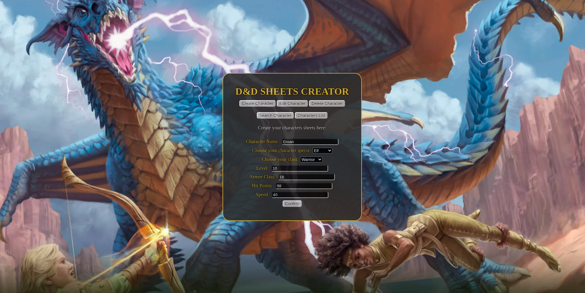
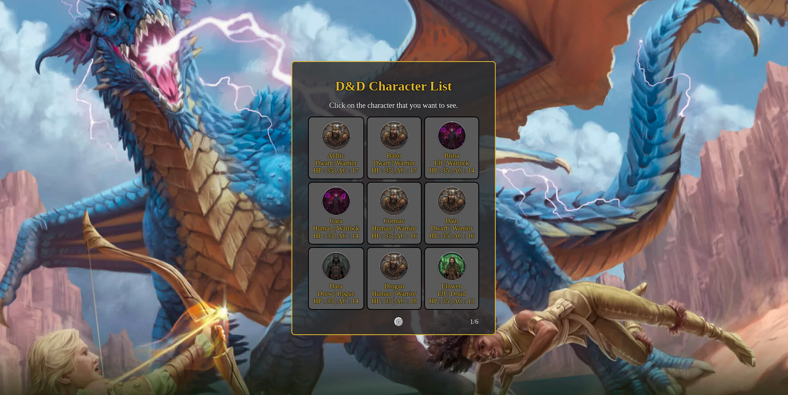
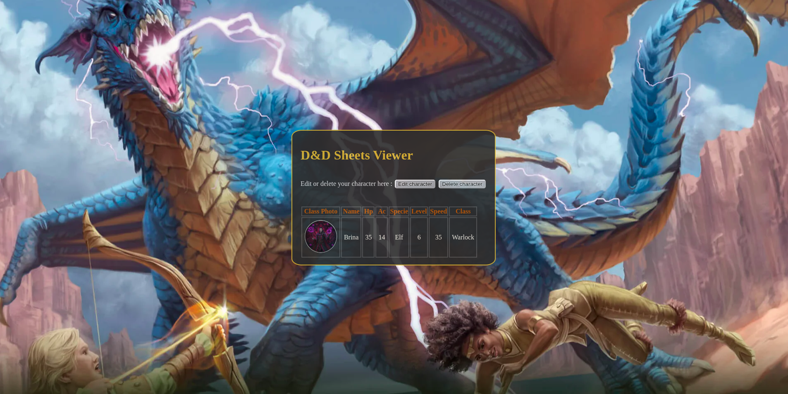
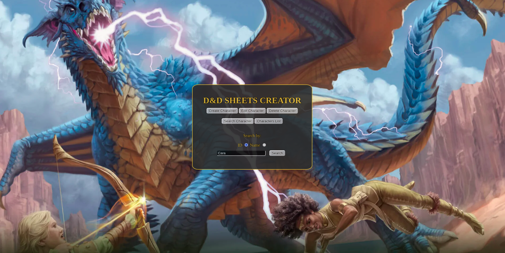

# 🛡️ D&D Sheet Creator

<p align="center">
  
  
  
</p>

A learning-focused project designed for players who need an **easy-to-use** and **open-source** platform to create and store their Dungeons & Dragons character sheets.

---

## 📸 Screenshots

<p align="center">
  
</p>

| Characters list | Character sheet | Search by name |
|:---:|:---:|:---:|
|  |  |  |

---

## 🚫 AI-Free Coding
This project is **hand-coded**. While I use AI for consulting, documentation, and learning English, 100% of the logic, functions, and styling are written by me to ensure a deep understanding of the technologies used.

---

## ⚔️ Features

* **Create characters:** Name, species, class, level, AC, HP and speed.
* **Characters list:** Paginated list; click a character to open its sheet.
* **Search:** Find a character by ID or by (partial) name.
* **Edit & delete:** Update or remove any saved sheet.
* **Data persistence:** Everything is stored in a PostgreSQL database.
* **Containerized database:** PostgreSQL runs in Docker for easy local setup.

---

## 🛠️ Tech Stack

### **Frontend & Backend**


### **Database & Infrastructure**


---

## 🚀 Getting Started

### Prerequisites

* [Node.js](https://nodejs.org/) (v18 or newer) and npm
* [Docker](https://www.docker.com/) with Docker Compose

### 1. Clone the repository

```bash
git clone https://github.com/hgiulliano/DnD-Sheet-Creator.git
cd DnD-Sheet-Creator/back-end
```

### 2. Start the database

```bash
docker compose up -d
```

This starts PostgreSQL 18 on `127.0.0.1:5433`. (PostgreSQL 18 is required because the tables use `uuidv7()`.)

### 3. Create the tables and (optionally) load sample data

```bash
docker compose exec -T character-sheet psql -U cleric -d postgres < database/init.sql
docker compose exec -T character-sheet psql -U cleric -d postgres < database/seed.sql   # 50 sample characters
```

> On Windows PowerShell, `<` doesn't work. Use:
> `Get-Content database/init.sql | docker compose exec -T character-sheet psql -U cleric -d postgres`

You only need to do this once. The data stays in the `postgres_data` Docker volume.

### 4. Start the server

```bash
npm install
npm start
```

### 5. Open the app

Go to **http://localhost:3000** — the Express server also serves the front-end, so there is nothing else to run.

> ⚠️ Run `npm start` from inside the `back-end/` folder: the server serves `../front-end/` using a relative path.

### Everyday use

```bash
cd back-end
docker compose up -d   # if the database container isn't running
npm start
```

To stop: `Ctrl + C` on the server, then `docker compose down` (add `-v` to also wipe the data).

---

## 🔌 API

| Method | Endpoint | Description |
|--------|----------|-------------|
| `GET` | `/api/sheets?page=1&limit=9` | List sheets (paginated) |
| `POST` | `/api/sheets` | Create a sheet |
| `GET` | `/api/sheets/:id` | Get one sheet with its stats |
| `GET` | `/api/sheets/search/:name?page=1&limit=9` | Search by name prefix |
| `PATCH` | `/api/sheets/:id` | Update a sheet |
| `DELETE` | `/api/sheets/:statsid` | Delete a character |

---

## 📂 Project Structure
```text
├── back-end/
│   ├── database/    # init.sql, queries.sql, seed.sql
│   ├── index.js     # Express server + API routes
│   └── docker-compose.yaml
├── front-end/
│   ├── assets/      # Class icons and favicon
│   ├── css/         # Stylesheets
│   ├── pages/       # sheet, list, search, edit and delete pages
│   ├── src/         # Frontend JS logic
│   └── index.html   # Main page (create character)
├── template/        # HTML/CSS base template
└── docs/screenshots # Images used in this README
```

---
